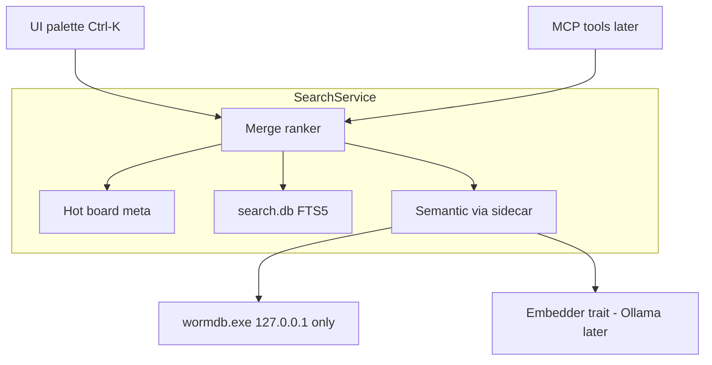

# Global Session Search for Agent Portal

| Field | Value |
| --- | --- |
| **Status** | Accepted (revision 5 — ship-now, **sidecar-first semantic**); Stage A+B implemented in tree |
| **Date** | 2026-07-18 |
| **Workspace** | `P:\agent-portal` · WormDB shipped in `src-tauri/binaries/` |

---

## Product decision (rev5)

**Capability completeness for semantic search requires the WormDB sidecar.**  
In-process FFI Path A does **not** wire `NamespaceRegistry` today (`wormdb_open` → bare store; `wormdb_exec` → `vector_registry: null`), so `mem_query` brute-forces and is not a ship path for library-scale semantic search.

| Path | Role in v1 ship |
| --- | --- |
| **WormDB sidecar (localhost TCP)** | **Required** semantic backend — full `mem_*` + HNSW |
| **FFI** | Deferred / future dogfood after W-FFI-1; not on the critical path |
| **Embeddings** | **Thin later step** — index + query pipeline ships with a pluggable `Embedder`; real Ollama model is Settings-gated (no default). Hash embedder for CI and structure tests only. |

**Ship-now goal:** global search is critical. Users get:

1. **Metadata** search across all agents (titles, project, path, model, id) — instant.
2. **Lexical content** (FTS5) — progressive, no embeddings.
3. **Semantic content** via sidecar + `mem_*` — progressive once an embedder is configured (or hash for tests).

MCP remains default **off** (Settings + auto-token). Design of MCP tools stays on the same `SearchService`.

---

## Overview

Agent Portal shows coding-agent sessions across many agents. Today only a project-rail filter exists. This feature adds a **global search** (`Ctrl/Cmd+K`) that finds sessions by metadata, transcript text (FTS), and meaning (WormDB sidecar).



---

## Goals

1. Global search across all agents/projects.
2. Content search: FTS now; semantic via **sidecar** (HNSW-capable).
3. Ship value immediately: meta + palette first; FTS and sidecar in the same release train.
4. Local-only; no cloud by default.
5. Cheap-path invariant: no full parse on `list_sessions` / board refresh.
6. Embeddings pluggable and **not** blocking meta/FTS; semantic queries need an embedder when the user enables semantic.

## Non-goals

- FFI as v1 semantic backend.
- Cloud embeddings by default / default Ollama embed model (user picks in Settings).
- MCP migrate/write tools in v1.
- Multi-node WormDB.
- Claiming semantic works without any embedder (hash is test-only).

---

## Architecture

### SearchService (`portal-core`)

```text
crates/portal-core/src/search/
  mod.rs          // SearchService, SearchQuery, SearchHit, SearchResponse
  meta.rs         // scan hot BoardSnapshot
  fts.rs          // search.db FTS5
  extract.rs      // CanonicalSession → indexable text / chunks
  merge.rs        // score tables
  semantic.rs     // SemanticBackend trait + SidecarBackend client
  embed.rs        // Embedder trait + HashEmbedder (+ Ollama later)
```

### Sidecar ownership

- GUI (or headless MCP later) **spawns and owns** one `wormdb` child:
  - Bind **`127.0.0.1` only** (ephemeral or fixed high port in settings).
  - Data dir: `<app_data_dir>/wormdb/`.
  - Namespace: **`portal-sessions`** (no colons — WormDB `validateNs`).
- Portal talks **WormWire** over TCP (`EXEC mem_*`).
- No dual FFI open of the same dir.
- Lifecycle: start on first semantic index/query when semantic enabled; stop with app; health probe; restart once on crash.

### Shipping binary

- **Shipped with the app** — never resolved from `PATH`.
- Vendored under `src-tauri/binaries/` as target-triple names Tauri expects:
  - `wormdb-x86_64-pc-windows-msvc.exe`
  - `wormdb-aarch64-apple-darwin`, `wormdb-x86_64-apple-darwin`, …
- Configured as Tauri `bundle.externalBin: ["binaries/wormdb"]` so installers place
  `wormdb[.exe]` next to the app / in Resources.
- Runtime resolve order (`resolve_wormdb_binary`): `PORTAL_WORMDB` override →
  resource dir → next to exe → `src-tauri/binaries` (dev).
- Vendor script: `scripts/vendor-wormdb.ps1` (Windows) / `scripts/vendor-wormdb.sh`.
- Windows: single-node wormdb is supported (HNSW included).

### Inventory & hot board

- `AppState` holds `Mutex<Option<Arc<BoardSnapshot>>>` updated by `refresh_board` / inventory scheduler.
- Inventory scheduler independent of Ollama (60s active / 180s idle).
- Metadata search never re-deserializes `board_cache` per keystroke.

### Content extract (FTS + chunks)

- Full timeline capped (~200k chars); skip meta turns, thinking; tool results **off**; tool args on, capped.
- Chunk for embed: ~512–1024 token-ish windows by turn boundaries; ids `{agent}/{native_id}/c{ix:04}`.
- Non-WORM vectors: worm arg always **`"0"`** string on `mem_add`.
- Shrink: track `chunk_ids_json` per session; delete orphans on reindex.

### Ranking (implementable)

| Match | Base score |
| --- | --- |
| Title exact | 100 |
| Title substring | 80 |
| Project label | 60 |
| Path | 50 |
| Model / native id | 40 |
| FTS BM25 | clamp 0..30 |
| Semantic cosine | clamp01(sim)×25; pure-semantic floor ~35 if no meta/FTS |

Collapse chunk hits to one session; prefer richest `match_kind`; recency mild boost; prefer non-live.

### Live sessions

- Index once while `maybe_live`; soft reindex if revision grows >25% after 15 min.
- UI badge: content may be incomplete for live sessions.

---

## API (IPC)

```rust
// search_sessions
struct SearchQuery {
  q: String,
  limit: u32,                 // default 30
  agent_ids: Option<Vec<String>>,
  project: Option<String>,
  include_content: bool,      // FTS
  include_semantic: bool,     // sidecar (no-op if embedder/sidecar unavailable)
}

struct SearchHit {
  agent_id: String,
  native_id: String,
  store_path: String,
  title: Option<String>,
  project_label: String,
  cwd_normalized: Option<String>,
  match_kind: SearchMatchKind, // recent | title | project | path | model | id | fts | semantic
  score: f32,
  snippet: Option<String>,
  maybe_live: bool,
  content_incomplete: bool,
}

struct SearchIndexStatus {
  fts: LayerStatus,
  semantic: SemanticStatus, // running, port, hnsw_live, chunks, embedder_id
}
```

Commands: `search_sessions`, `search_index_status`, later `rebuild_search_index` / clear.

---

## UI

- `Ctrl/Cmd+K` command palette (app shell).
- Results: agent accent, title, project, snippet, match kind.
- Select → BoardStore: navigate board, `selectProject`, unhide agent, `requestPreview`.
- Min 1 char; empty open → recent 20.

---

## Settings (ship-now)

| Key | Default | Notes |
| --- | --- | --- |
| `content_search_enabled` | true | FTS worker |
| `semantic_search_enabled` | false until embedder set | Sidecar spawn when true |
| `ollama_embed_model` | **none** | Explicit Settings pick (product decision) |
| `wormdb_binary_path` | bundled or empty | Override |
| `wormdb_port` | 0 = ephemeral | Loopback only |
| `mcp_enabled` | false | Later |

---

## Security

- Sidecar: **127.0.0.1 only**; optional WormDB AUTH token if exposed beyond portal.
- FTS + WormDB corpora are sensitive local copies of transcript text — document in SECURITY.md when first written.
- Snippets never logged.
- Kill switches: disable FTS / semantic independently.
- MCP (later): default off, auto bearer, read-only tools.

---

## Ship sequence (rev5)

Compressed for **capability-complete semantic via sidecar**, embeddings thin.
**MCP was pulled forward** so we can test at scale and iterate on WormDB.

| # | Deliverable | Status |
| --- | --- | --- |
| **1** | Hot board + `search_sessions` metadata + inventory notify | **Done** |
| **2** | Palette + BoardStore jump | **Done** |
| **3** | `search.db` FTS + extract + indexer | **Done** (progressive) |
| **4** | WormWire client + sidecar spawn | **Done** (lifecycle + STATUS) |
| **5** | **MCP stdio (`portal-mcp`)** | **Done** — see `docs/mcp.md` |
| **6** | Hybrid merge + `mem_*` semantic index | **Done** (hash embedder + HNSW sidecar) |
| **7** | Ollama embedder for real semantic quality | Next (hash is plumbing/recall baseline) |
| **8** | SECURITY/README + settings kill switches | Partial (SECURITY notes) |

FFI PRs and W-FFI-1 are **out of the critical path**.

---

## Key decisions (rev5)

1. **Sidecar is the only v1 semantic backend** (capability complete / HNSW).
2. **FFI deferred** until upstream registry wiring; not required to ship.
3. **Three-layer hybrid**: meta + FTS + semantic (not vectors-only).
4. **Embeddings pluggable; no default model** — semantic optional until user configures.
5. **Namespace `portal-sessions`**; worm **`"0"`**; loopback sidecar only.
6. **Hot board + Ollama-independent inventory**.
7. **MCP default off**.
8. **Agent-agnostic** — no private agent search DBs.

---

## Open questions (non-blocking)

1. Disk budget caps for huge libraries.
2. Activity status strip vs Settings-only for index ETA.
3. Preview scroll-to-match timing.

---

## References

- Portal: `adapter.rs`, `dto.rs`, `ir.rs`, `index/mod.rs`, `naming.rs`, `state.rs`, board UI.
- WormDB: server HNSW path, `mem_*` (`docs/architecture/agent-memory.md`), Windows single-node (`docs/WINDOWS.md`).
- Prior design iterations: temp design rev1–4 (FFI-first, superseded by rev5 for ship path).
